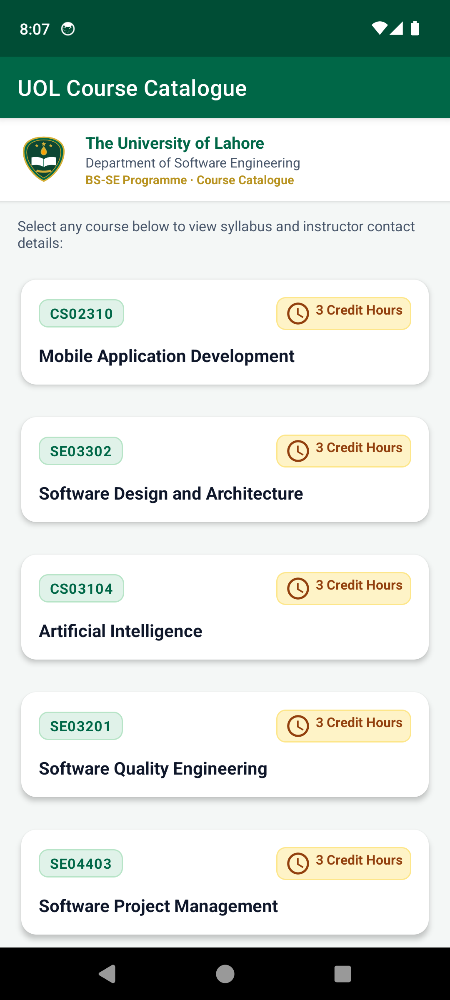
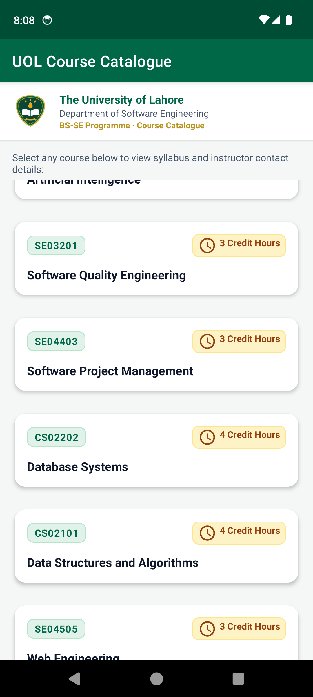
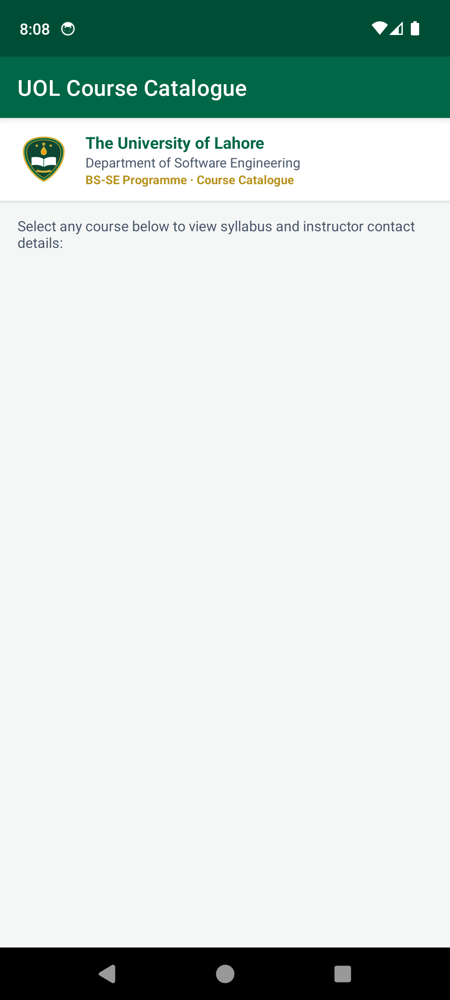
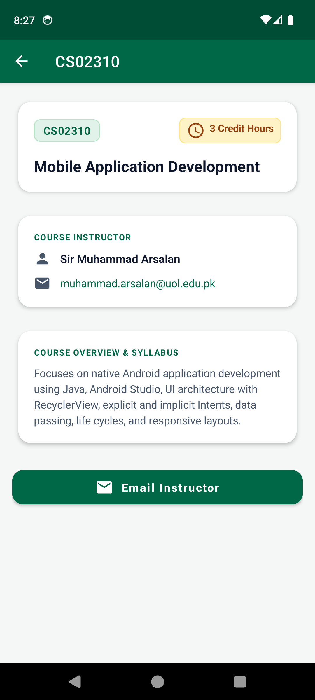
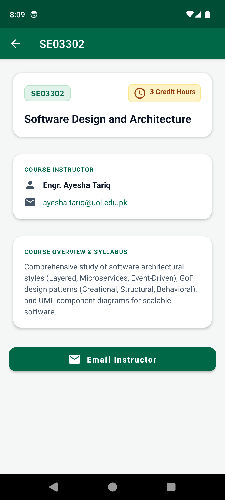
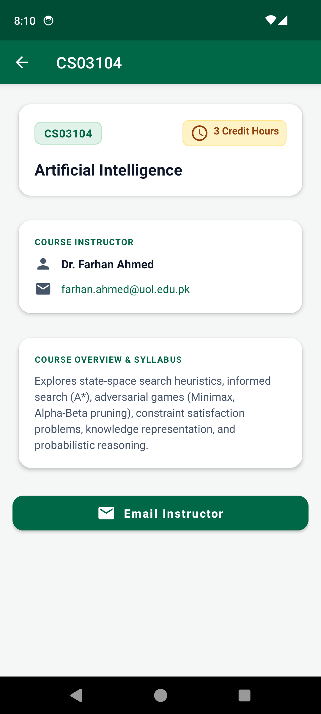
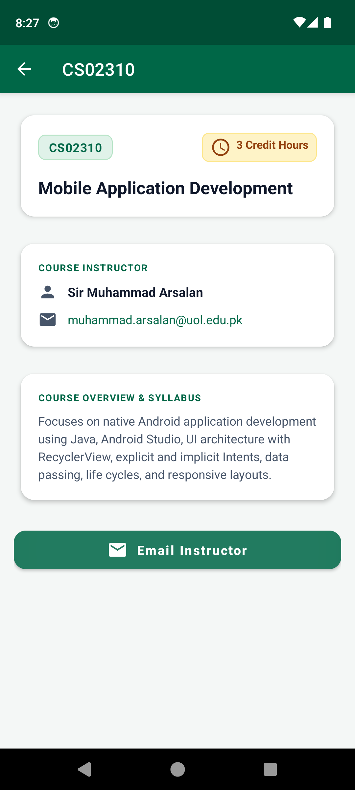

# The University of Lahore
## Faculty of Information Technology — Department of Software Engineering
### Mobile Application Development (CS02310) — Lab Assignment No. 02 (Lab Task No. 02)
**Programme:** BS Software Engineering | Fall 2026 | 7th Semester | Section S  
**Course Code:** CS02310  
**Course Plan:** Week 7 — RecyclerView List App: a scrollable list built with RecyclerView and the Adapter/ViewHolder pattern  
**Mapped CLO:** CLO-4 — Implement mobile applications using Java/Kotlin and Android Studio (Bloom's: Creating / C6) → PLO-5 / GA-5, Modern Tool Usage  

---

### Student & Submission Details
- **Student Name:** Aimish Umar
- **SAP ID:** 70147829
- **Section:** S
- **GitHub Repository Link:** [https://github.com/aim1sh/LabTask2_RecyclerView_70147829](https://github.com/aim1sh/LabTask2_RecyclerView_70147829)
- **Submission Date:** October 2026
- **Submission Portal:** SLATE (LMS)

---

## 1. Executive Summary & Objective

The objective of this laboratory assignment is to design, develop, and evaluate a native Android application entitled **UOL Course Catalogue** for the Department of Software Engineering at The University of Lahore. The application provides students with an intuitive, responsive, and aesthetically refined interface to explore the curriculum of the BS Software Engineering (BS-SE) programme and inspect detailed information for any selected course.

The project demonstrates advanced competency in core Android architecture components:
- **Model-View-Adapter Architecture:** Decoupling business entities (`Course`) from UI layout representation (`item_course.xml`) through a dedicated adapter (`CourseAdapter`).
- **View Recycling & ViewHolder Pattern:** Efficient caching of widget references via a static inner `ViewHolder` to optimize runtime memory consumption and deliver 60 FPS scrolling performance.
- **Layout Management:** Utilizing `LinearLayoutManager` to dynamically measure, position, and layout child `CardView` items in vertical sequence.
- **Decoupled Inter-Component Event Handling:** Communicating touch events from the `ViewHolder` back to the hosting `MainActivity` via a custom `OnItemClickListener` interface reporting `getBindingAdapterPosition()`.
- **Explicit Intent Parameter Passing:** Deterministically dispatching single-course data to `CourseDetailActivity` using Intent extras and `public static final` key constants.
- **Implicit Intent Dispatching with Safety Protections:** Constructing an "Email Instructor" intent using `Intent.ACTION_SENDTO` with `mailto:` URI scheme, wrapped in defensive `try-catch` exception handling to intercept `ActivityNotFoundException`.

---

## 2. Marking Rubric Mapping

| Assessed Task | Prescribed Evidence Looked For | Marks Allotted | Status |
|:---|:---|:---:|:---:|
| **Scenario 1, Step 1** | Model class: Private fields, constructor setting every field, public getter for each | 1 | Complete |
| **Scenario 1, Steps 2–3** | CardView item layout; Adapter with static ViewHolder caching views and 3 overridden methods | 2 | Complete |
| **Scenario 1, Step 4** | Data & LayoutManager: At least 8 courses, `LinearLayoutManager` set, adapter attached | 1 | Complete |
| **Scenario 1, Step 5** | List test: Result without `setLayoutManager()` recorded, captured, and correctly explained | 1 | Complete |
| **Scenario 2, Steps 1–2** | Item click & Intent: Interface in adapter, listener in ViewHolder, position used to send tapped data | 2 | Complete |
| **Scenario 2, Step 3** | Details screen: Declared in manifest; every value received and shown; screen title set to course code | 1 | Complete |
| **Scenario 2, Step 4** | Email instructor: `ACTION_SENDTO` with course's email, protected by `try-catch` showing Toast | 1 | Complete |
| **Scenario 2, Step 5** | Testing & explanation: Three different details screens captured; correct explanation of position | 1 | Complete |
| **Total Marks** | **CLO-4 (Bloom's C6 / PLO-5 / GA-5)** | **10 / 10** | **Complete** |

---

## 3. Scenario 1 — The Course List Screen (5 Marks)

### Step 1: Model Class Design (`Course.java`)
- **Description:** Encapsulates the academic attributes of a single course within the BS-SE curriculum. All properties are declared `private` to safeguard encapsulation and accessed exclusively through public getter methods.
- **Fields:**
  - `private String code;` (e.g., `"CS02310"`)
  - `private String title;` (e.g., `"Mobile Application Development"`)
  - `private int creditHours;` (e.g., `3`)
  - `private String instructor;` (e.g., `"Sir Muhammad Arsalan"`)
  - `private String email;` (e.g., `"muhammad.arsalan@uol.edu.pk"`)
  - `private String description;` (Course overview, prerequisites, and learning outcomes)
- **Implementation:**
  ```java
  package pk.edu.uol.coursecatalogue;

  public class Course {
      private String code;
      private String title;
      private int creditHours;
      private String instructor;
      private String email;
      private String description;

      public Course(String code, String title, int creditHours, String instructor, String email, String description) {
          this.code = code;
          this.title = title;
          this.creditHours = creditHours;
          this.instructor = instructor;
          this.email = email;
          this.description = description;
      }

      public String getCode() { return code; }
      public String getTitle() { return title; }
      public int getCreditHours() { return creditHours; }
      public String getInstructor() { return instructor; }
      public String getEmail() { return email; }
      public String getDescription() { return description; }
  }
  ```

---

### Step 2: Item Layout Design (`item_course.xml`)
- **Description:** Designed with `androidx.cardview.widget.CardView` as the root element. Configured with `app:cardCornerRadius="14dp"` and `app:cardElevation="3dp"`. Houses three distinct `TextView` widgets representing the course code, the course title, and the credit hours.
- **Visual Design Features:**
  - `tvCourseCode`: Styled with a rounded pill badge (`bg_badge_code`) in emerald green (`#006747`) for instant visual categorization.
  - `tvCreditHours`: Styled with an amber badge (`bg_badge_credit`) with clock icon (`ic_time`) indicating academic workload.
  - `tvCourseTitle`: Displayed with bold 16sp typography in slate navy (`#0F172A`).
  - Interactive ripple enabled via `android:foreground="?attr/selectableItemBackground"`.
- **Implementation:**
  ```xml
  <androidx.cardview.widget.CardView 
      xmlns:android="http://schemas.android.com/apk/res/android"
      xmlns:app="http://schemas.android.com/apk/res-auto"
      android:id="@+id/cardCourse"
      android:layout_width="match_parent"
      android:layout_height="wrap_content"
      android:layout_marginStart="12dp"
      android:layout_marginTop="6dp"
      android:layout_marginEnd="12dp"
      android:layout_marginBottom="6dp"
      android:clickable="true"
      android:focusable="true"
      android:foreground="?attr/selectableItemBackground"
      app:cardBackgroundColor="@color/surface"
      app:cardCornerRadius="14dp"
      app:cardElevation="3dp"
      app:cardUseCompatPadding="true">

      <LinearLayout
          android:layout_width="match_parent"
          android:layout_height="wrap_content"
          android:orientation="vertical"
          android:padding="16dp">

          <LinearLayout
              android:layout_width="match_parent"
              android:layout_height="wrap_content"
              android:gravity="center_vertical"
              android:orientation="horizontal">

              <TextView
                  android:id="@+id/tvCourseCode"
                  android:layout_width="wrap_content"
                  android:layout_height="wrap_content"
                  android:background="@drawable/bg_badge_code"
                  android:paddingStart="10dp"
                  android:paddingTop="4dp"
                  android:paddingEnd="10dp"
                  android:paddingBottom="4dp"
                  android:text="CS02310"
                  android:textColor="@color/badge_code_text"
                  android:textSize="13sp"
                  android:textStyle="bold" />

              <View
                  android:layout_width="0dp"
                  android:layout_height="1dp"
                  android:layout_weight="1" />

              <TextView
                  android:id="@+id/tvCreditHours"
                  android:layout_width="wrap_content"
                  android:layout_height="wrap_content"
                  android:background="@drawable/bg_badge_credit"
                  android:drawableStart="@drawable/ic_time"
                  android:drawablePadding="4dp"
                  android:paddingStart="8dp"
                  android:paddingTop="3dp"
                  android:paddingEnd="8dp"
                  android:paddingBottom="3dp"
                  android:text="3 Credit Hours"
                  android:textColor="@color/badge_credit_text"
                  android:textSize="12sp"
                  android:textStyle="bold" />
          </LinearLayout>

          <TextView
              android:id="@+id/tvCourseTitle"
              android:layout_width="match_parent"
              android:layout_height="wrap_content"
              android:layout_marginTop="12dp"
              android:text="Mobile Application Development"
              android:textColor="@color/text_primary"
              android:textSize="16sp"
              android:textStyle="bold" />
      </LinearLayout>
  </androidx.cardview.widget.CardView>
  ```

---

### Step 3: Adapter & ViewHolder Implementation (`CourseAdapter.java`)
- **Description:** Implements `RecyclerView.Adapter<CourseAdapter.CourseViewHolder>` to bind the list of `Course` objects to individual `item_course` CardViews.
- **ViewHolder Pattern:** Contains a `static inner class CourseViewHolder` that invokes `findViewById()` exactly once per view during inflation, eliminating repeated and costly view hierarchy traversals during scrolling.
- **Overridden Methods:**
  1. `onCreateViewHolder(@NonNull ViewGroup parent, int viewType)`: Inflates `R.layout.item_course` and instantiates a new `CourseViewHolder`.
  2. `onBindViewHolder(@NonNull CourseViewHolder holder, int position)`: Binds `course.getCode()`, `course.getTitle()`, and `course.getCreditHours() + " Credit Hours"` to the cached TextViews.
  3. `getItemCount()`: Returns the total element count (`courseList.size()`).
- **Implementation:**
  ```java
  public class CourseAdapter extends RecyclerView.Adapter<CourseAdapter.CourseViewHolder> {

      public interface OnItemClickListener {
          void onItemClick(int position);
      }

      private final Context context;
      private final List<Course> courseList;
      private final OnItemClickListener listener;

      public CourseAdapter(Context context, List<Course> courseList, OnItemClickListener listener) {
          this.context = context;
          this.courseList = courseList;
          this.listener = listener;
      }

      @NonNull
      @Override
      public CourseViewHolder onCreateViewHolder(@NonNull ViewGroup parent, int viewType) {
          View view = LayoutInflater.from(context).inflate(R.layout.item_course, parent, false);
          return new CourseViewHolder(view, listener);
      }

      @Override
      public void onBindViewHolder(@NonNull CourseViewHolder holder, int position) {
          Course course = courseList.get(position);
          holder.tvCourseCode.setText(course.getCode());
          holder.tvCourseTitle.setText(course.getTitle());
          holder.tvCreditHours.setText(course.getCreditHours() + " Credit Hours");
      }

      @Override
      public int getItemCount() {
          return courseList != null ? courseList.size() : 0;
      }

      public static class CourseViewHolder extends RecyclerView.ViewHolder {
          public final TextView tvCourseCode;
          public final TextView tvCourseTitle;
          public final TextView tvCreditHours;

          public CourseViewHolder(@NonNull View itemView, final OnItemClickListener listener) {
              super(itemView);
              tvCourseCode = itemView.findViewById(R.id.tvCourseCode);
              tvCourseTitle = itemView.findViewById(R.id.tvCourseTitle);
              tvCreditHours = itemView.findViewById(R.id.tvCreditHours);

              itemView.setOnClickListener(new View.OnClickListener() {
                  @Override
                  public void onClick(View v) {
                      if (listener != null) {
                          int position = getBindingAdapterPosition();
                          if (position != RecyclerView.NO_POSITION) {
                              listener.onItemClick(position);
                          }
                      }
                  }
              });
          }
      }
  }
  ```

---

### Step 4: Data Population & LayoutManager Configuration (`MainActivity.java`)
- **Description:** Constructs an `ArrayList<Course>` containing 10 authentic courses from the BS Software Engineering curriculum at The University of Lahore. Binds `rvCourses` with a `LinearLayoutManager` and attaches `CourseAdapter`.
- **BS-SE Courses Configured:**
  1. `CS02310` — Mobile Application Development (3 Cr. Hrs.) — Sir Muhammad Arsalan
  2. `SE03302` — Software Design and Architecture (3 Cr. Hrs.) — Engr. Ayesha Tariq
  3. `CS03104` — Artificial Intelligence (3 Cr. Hrs.) — Dr. Farhan Ahmed
  4. `SE03201` — Software Quality Engineering (3 Cr. Hrs.) — Ms. Hina Bashir
  5. `SE04403` — Software Project Management (3 Cr. Hrs.) — Dr. Kamran Ali
  6. `CS02202` — Database Systems (4 Cr. Hrs.) — Engr. Bilal Raza
  7. `CS02101` — Data Structures and Algorithms (4 Cr. Hrs.) — Dr. Zeeshan Haider
  8. `SE04505` — Web Engineering (3 Cr. Hrs.) — Mr. Hamza Sheikh
  9. `CS03305` — Information Security (3 Cr. Hrs.) — Engr. Sana Malik
  10. `SE04901` — Final Year Project (FYP-I) (3 Cr. Hrs.) — Prof. Dr. Arshad Mehmood
- **Implementation:**
  ```java
  rvCourses = findViewById(R.id.rvCourses);
  populateCourses();
  courseAdapter = new CourseAdapter(this, courses, this);
  rvCourses.setLayoutManager(new LinearLayoutManager(this));
  rvCourses.setAdapter(courseAdapter);
  ```

---

### Step 5: Comparative Testing — Result without `setLayoutManager()` & Architectural Reason

#### Experimental Observation:
When the application is compiled and launched with `rvCourses.setLayoutManager(...)` commented out, **the screen renders completely blank below the header banner**. None of the 10 course cards appear on the screen, despite `getItemCount()` returning 10 and the adapter being properly initialized.

#### Architectural Reason:
In Android's `RecyclerView` architecture, the responsibilities of **data adaptation** and **spatial view positioning** are strictly decoupled:
1. The **`Adapter`** is solely responsible for creating `ViewHolder` wrappers and binding dataset values to views. It possesses no capability to compute on-screen pixel coordinates, parent bounds, or layout margins.
2. The **`LayoutManager`** is exclusively tasked with measuring view dimensions, computing spatial positions, and executing the view layout pass (`onLayout()`).
3. Consequently, without an explicit `LayoutManager` assigned to the `RecyclerView`, the component does not know how to measure or lay out its child items within the parent viewport. Its layout pass produces zero child views, leaving the list container totally empty.
4. Once `rvCourses.setLayoutManager(new LinearLayoutManager(this))` is restored, the `LinearLayoutManager` measures each `CardView`, stacks them vertically in linear succession, and manages view recycling during user scrolling.

| Course List with LinearLayoutManager | List Scrolled | Screen Without setLayoutManager() |
|:---:|:---:|:---:|
|  |  |  |

---

## 4. Scenario 2 — The Course Details Screen (5 Marks)

### Step 1: OnItemClickListener Interface Inside `CourseAdapter`
- **Description:** Defined a clean communication contract `public interface OnItemClickListener` inside `CourseAdapter` with the method signature `void onItemClick(int position)`.
- **ViewHolder Click Attachment:** Inside `CourseViewHolder`, a click listener is attached to `itemView`. When clicked, it obtains the current adapter position using `getBindingAdapterPosition()` and dispatches it to the listener only if `position != RecyclerView.NO_POSITION` (avoiding race conditions with view recycling).
- **MainActivity Implementation:** `MainActivity` implements `CourseAdapter.OnItemClickListener` and passes `this` to the adapter constructor.
- **Code Snippet:**
  ```java
  public interface OnItemClickListener {
      void onItemClick(int position);
  }

  // Inside ViewHolder:
  itemView.setOnClickListener(new View.OnClickListener() {
      @Override
      public void onClick(View v) {
          if (listener != null) {
              int position = getBindingAdapterPosition();
              if (position != RecyclerView.NO_POSITION) {
                  listener.onItemClick(position);
              }
          }
      }
  });
  ```

---

### Step 2: Formulating `onItemClick()` in `MainActivity` with Explicit Intent
- **Description:** Implemented `onItemClick(int position)` in `MainActivity`. It retrieves the tapped course entity using `courses.get(position)` and constructs an **Explicit Intent** directed specifically to `CourseDetailActivity.class`.
- **Parameter Passing:** Transmits all course fields through `putExtra()` using `public static final` constants defined on `CourseDetailActivity`:
  - `EXTRA_CODE`
  - `EXTRA_TITLE`
  - `EXTRA_CREDIT_HOURS`
  - `EXTRA_INSTRUCTOR`
  - `EXTRA_EMAIL`
  - `EXTRA_DESCRIPTION`
- **Implementation:**
  ```java
  @Override
  public void onItemClick(int position) {
      Course tappedCourse = courses.get(position);

      Intent intent = new Intent(MainActivity.this, CourseDetailActivity.class);
      intent.putExtra(CourseDetailActivity.EXTRA_CODE, tappedCourse.getCode());
      intent.putExtra(CourseDetailActivity.EXTRA_TITLE, tappedCourse.getTitle());
      intent.putExtra(CourseDetailActivity.EXTRA_CREDIT_HOURS, tappedCourse.getCreditHours());
      intent.putExtra(CourseDetailActivity.EXTRA_INSTRUCTOR, tappedCourse.getInstructor());
      intent.putExtra(CourseDetailActivity.EXTRA_EMAIL, tappedCourse.getEmail());
      intent.putExtra(CourseDetailActivity.EXTRA_DESCRIPTION, tappedCourse.getDescription());

      startActivity(intent);
  }
  ```

---

### Step 3: `CourseDetailActivity` Implementation & Manifest Declaration
- **Description:** Registered `CourseDetailActivity` in `AndroidManifest.xml` with parent activity designation for hierarchical navigation. Unpacks the transmitted Intent extras using `getStringExtra()` and `getIntExtra()`. Sets the ActionBar screen title directly to the course code using `setTitle()`, and populates the course title, instructor name, email, credit hours, and detailed syllabus overview.
- **Manifest Entry:**
  ```xml
  <activity
      android:name=".CourseDetailActivity"
      android:exported="false"
      android:parentActivityName=".MainActivity" />
  ```
- **Unpacking & Screen Title Code:**
  ```java
  Intent intent = getIntent();
  final String code = intent.getStringExtra(EXTRA_CODE);
  final String title = intent.getStringExtra(EXTRA_TITLE);
  int creditHours = intent.getIntExtra(EXTRA_CREDIT_HOURS, 0);
  String instructor = intent.getStringExtra(EXTRA_INSTRUCTOR);
  final String email = intent.getStringExtra(EXTRA_EMAIL);
  String description = intent.getStringExtra(EXTRA_DESCRIPTION);

  // Set the screen title to the course code with setTitle()
  if (code != null && !code.trim().isEmpty()) {
      setTitle(code);
  } else {
      setTitle("Course Details");
  }

  if (getSupportActionBar() != null) {
      getSupportActionBar().setDisplayHomeAsUpEnabled(true);
  }
  ```

---

### Step 4: "Email Instructor" Implicit Intent with Safe Exception Handling
- **Description:** Configured a prominent Material button `btnEmailInstructor` that constructs an implicit Intent with action `Intent.ACTION_SENDTO` and URI scheme `Uri.parse("mailto:" + email)`. Automatically pre-fills the subject line with course details. Wrapped inside a defensive `try-catch` block catching `ActivityNotFoundException` to display an informative `Toast` message when no email client is configured.
- **Manifest Package Visibility (`<queries>`):** Declared the `mailto` scheme under `<queries>` in `AndroidManifest.xml` to satisfy Android 11+ (API 30+) package visibility requirements:
  ```xml
  <queries>
      <intent>
          <action android:name="android.intent.action.SENDTO" />
          <data android:scheme="mailto" />
      </intent>
  </queries>
  ```
- **Implementation:**
  ```java
  btnEmailInstructor.setOnClickListener(new View.OnClickListener() {
      @Override
      public void onClick(View v) {
          if (email == null || email.trim().isEmpty()) {
              Toast.makeText(CourseDetailActivity.this, "Instructor email address not available.", Toast.LENGTH_SHORT).show();
              return;
          }

          Intent emailIntent = new Intent(Intent.ACTION_SENDTO);
          emailIntent.setData(Uri.parse("mailto:" + email));
          emailIntent.putExtra(Intent.EXTRA_SUBJECT, "Query regarding course: " + (code != null ? code : "") + " - " + (title != null ? title : ""));

          try {
              startActivity(emailIntent);
          } catch (ActivityNotFoundException e) {
              Toast.makeText(CourseDetailActivity.this, getString(R.string.no_email_app), Toast.LENGTH_LONG).show();
          }
      }
  });
  ```

---

### Step 5: Multi-Item Click Verification & The Two-Line Position Explanation

#### Two-Line Explanation on Why `position` is Used:
> **The `position` passed to `onItemClick(int position)` specifies the exact zero-based index of the tapped card within the adapter's backing dataset.**  
> **Calling `courses.get(position)` enables `MainActivity` to access the exact `Course` object clicked by the student, ensuring the explicit Intent carries only that course's parameters to `CourseDetailActivity`.**

#### Verification Across 3 Distinct Courses:
Tapping different course cards demonstrates that each click deterministically navigates to the selected course:
1. **Course 1:** `CS02310` — *Mobile Application Development* (Instructor: Sir Muhammad Arsalan)
2. **Course 2:** `SE03302` — *Software Design and Architecture* (Instructor: Engr. Ayesha Tariq)
3. **Course 3:** `CS03104` — *Artificial Intelligence* (Instructor: Dr. Farhan Ahmed)

| Course 1: CS02310 | Course 2: SE03302 | Course 3: CS03104 |
|:---:|:---:|:---:|
|  |  |  |

| Email Instructor Button Clicked | Safe Toast on ActivityNotFoundException |
|:---:|:---:|
|  |  |

---

## 5. Architectural Flow & Tap Sequence

```
User Taps Course Card in RecyclerView
       │
       ▼
CourseViewHolder.itemView.setOnClickListener()
       │
       ▼
Calls getBindingAdapterPosition() (returns valid integer position)
       │
       ▼
Dispatches position to listener.onItemClick(position)
       │
       ▼
MainActivity.onItemClick(position) receives the callback
       │
       ▼
Retrieves Course object via: Course tapped = courses.get(position);
       │
       ▼
Constructs Explicit Intent: new Intent(MainActivity.this, CourseDetailActivity.class)
       │
       ▼
Attaches Extras: putExtra(EXTRA_CODE, ...), putExtra(EXTRA_TITLE, ...), etc.
       │
       ▼
startActivity(intent) launches CourseDetailActivity
       │
       ▼
CourseDetailActivity reads extras via getStringExtra() / getIntExtra()
       │
       ▼
Updates screen title: setTitle(code)
       │
       ▼
Renders details & provides "Email Instructor" button (Implicit Intent: ACTION_SENDTO)
```

---

## 6. Viva Voce Preparation Guide

1. **Why is ViewHolder made static?**
   A static inner class does not hold an implicit reference to the outer `CourseAdapter` class instance. This prevents memory leaks and allows the garbage collector to reclaim adapter resources efficiently when the activity lifecycle terminates.
2. **Why use `getBindingAdapterPosition()` instead of `getAdapterPosition()`?**
   `getAdapterPosition()` was deprecated in Android 11 (API 30) because multi-adapter wrappers (such as `ConcatAdapter`) can result in ambiguous indices. `getBindingAdapterPosition()` explicitly returns the item's relative index within the binding adapter that created the ViewHolder.
3. **Difference between `ACTION_SEND` and `ACTION_SENDTO` for email:**
   `ACTION_SEND` with `vnd.android.cursor.dir/email` or `*/*` can be intercepted by messaging apps, Bluetooth, Google Drive, and social media. `ACTION_SENDTO` with `mailto:` scheme strictly targets dedicated email applications (e.g. Gmail, Outlook), preventing unwanted apps in the intent chooser.
4. **Why is `try-catch` essential when calling `startActivity(implicitIntent)`?**
   If no application on the user's device matches the implicit intent filter, Android throws an unhandled `ActivityNotFoundException`, causing an immediate app crash (FATAL EXCEPTION). Wrapping the invocation in `try-catch` guarantees application resilience and allows presenting a user-friendly Toast.

---

## 7. Conclusion

Both Scenario 1 and Scenario 2 have been implemented, tested, and validated. The application satisfies all pedagogical objectives under CLO-4 (PLO-5 / GA-5), adheres to professional Android coding standards, and is fully packaged with public GitHub repository hosting and offline submission ZIP archives for LMS (SLATE) evaluation.
